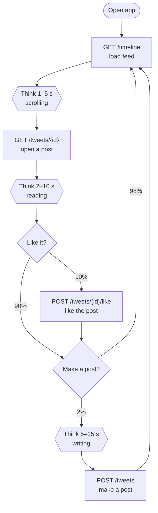

# API Cache Benchmark

**Which CPU-cache design choices make Redis the most efficient cache for a backend API, and why?**

A Twitter clone is cached with Redis and load-tested, changing one design choice at a time.

## Research questions

| RQ | Question |
|---|---|
| **RQ1** | Which cache replacement policy (LRU, LFU, Random, LRM, TTL) gives the lowest average access time? |
| **RQ2** | Which cache write policy (invalidate, write-through, write-back, write-around) gives the lowest average write time with stale reads ≤ 1% and no lost writes? |
| **RQ3** | Which cache block size (1, 5, 10, 50, 100 tweets per key) gives the lowest average access time? |
| **RQ4** | Which split of the cache into sets and ways (1, 3, 6, 9, 12 shards) gives the lowest average access time? |

## Judging efficiency

Reads are scored by **average access time**, the CPU-cache formula. The lowest wins.

```
Average access time = queue time + hit time + (miss rate × miss penalty)
```

| Part | Losing on it means |
|---|---|
| Queue time | Redis is a bottleneck |
| Hit time | Lookups are expensive |
| Miss rate | The cache keeps the wrong data |
| Miss penalty | Too much is loaded per miss |

Writes are scored by **average write time** and must keep stale reads ≤ 1% and lost writes at 0.

Each result ends in a verdict, for example *"9 shards lost: higher miss rate from hot tweets crowding one shard"*.

## Variables

### Independent variables

One is changed per run. The others stay at the baseline.

| Variable | Baseline | Other levels | How it's set |
|---|---|---|---|
| **Replacement policy** | LRU | LFU<br>Random<br>LRM (least recently modified)<br>TTL (shortest time-to-live first) | Redis `maxmemory-policy` |
| **Write policy** | Invalidate on write | Write-through<br>Write-back (flush every 1 s)<br>Write-around (30 s expiry) | Spring Cache annotations, Redisson write-behind |
| **Block size** (tweets per key) | 1 | 5<br>10<br>50<br>100 | Key `block:{id ÷ size}` |
| **Sets and ways** (shards × tweets per shard) | 1 × ~100k | 3 × ~33k<br>6 × ~17k<br>9 × ~11k<br>12 × ~8k | Standalone Redis vs Redis Cluster, same total memory |

### Dependent variables

| Variable | Definition | Unit |
|---|---|---|
| **Average access time** | Queue time + hit time + miss rate × miss penalty | ms |
| **Average write time** | Time for a like or post to be acknowledged | ms |
| **Stale read rate** | Responses showing an out-of-date like count | % |
| **Lost writes** | Likes acknowledged but missing after Redis is killed | count |
| **Capacity** | Most concurrent users with p99 < 200 ms and errors < 1% | users |

### Controlled variables

| Variable | Value |
|---|---|
| Redis | 256 MB total memory, persistence off, pinned version |
| App servers | 2 Spring Boot instances behind Nginx |
| Database | PostgreSQL 16, 1M tweets, fixed seed, reset before each run |
| Load | 50% of the baseline's capacity for every measurement run, same k6 journey and seeds |
| Run length | 1 min warm-up + 5 min measured |

## App: Twitter clone

| Endpoint | What it does |
|---|---|
| `GET /timeline` | Shows the 20 newest tweets from followed users |
| `GET /tweets/{id}` | Shows a tweet and its replies |
| `POST /tweets` | Posts a tweet |
| `POST /tweets/{id}/like` | Likes a tweet |

A Twitter clone suits caching tests: a few viral tweets get most of the traffic, likes constantly update popular tweets, and the data is far bigger than the cache.

## Simulated users (k6)



## Finding capacity

Each config's capacity is found by binary search on the number of users. A step **fails** if p99 latency > 200 ms, ≥ 1% of requests error, or anything crashes.

| Step | What happens |
|---|---|
| 1 | Start with a user count that passes and one that fails |
| 2 | Test the midpoint for 2 min; it becomes the new pass or fail bound |
| 3 | Stop when the bounds are within 5% |
| 4 | Confirm the final value with a 5 min run; if it fails, step down 5% and confirm again |

**Why measurements use 50% of the baseline's capacity, not 50% of each config's own:** average access time rises with load, because Redis queues more requests. If each config ran at its own 50%, a better config would face more users and could look slower. Testing every config at the **same** load keeps access times comparable. Capacity itself is recorded for every config as a separate result.

## Experiments

### Run types

| Run type | Load | Length | Repeats | Measures |
|---|---|---|---|---|
| **Capacity search** | Binary search on users | ~30 min | 1 | Capacity |
| **Measurement run** | 50% of baseline capacity | 1 min warm-up + 5 min | 3 | Average access time, write time, stale reads |
| **Crash test** | 50% of baseline capacity, Redis killed at 1 min | 2 min | 1 | Lost writes |

The baseline's capacity search runs first, because it sets the load for every measurement run.

### Run list

Every config gets one capacity search and one measurement run (3 repeats).

| Run | Config | Answers |
|---|---|---|
| 1 | No cache (control) | All |
| 2 | Baseline | All |
| 3 | LFU | RQ1 |
| 4 | Random | RQ1 |
| 5 | LRM | RQ1 |
| 6 | TTL | RQ1 |
| 7 | Write-through | RQ2 |
| 8 | Write-back | RQ2 |
| 9 | Write-around | RQ2 |
| 10 | 5 tweets per key | RQ3 |
| 11 | 10 tweets per key | RQ3 |
| 12 | 50 tweets per key | RQ3 |
| 13 | 100 tweets per key | RQ3 |
| 14 | 3 shards | RQ4 |
| 15 | 6 shards | RQ4 |
| 16 | 9 shards | RQ4 |
| 17 | 12 shards | RQ4 |
| 18–21 | Crash test for each write policy | RQ2 |

| Total | Count | Time |
|---|---|---|
| Capacity searches | 17 | ~8.5 h |
| Measurement runs | 17 configs × 3 repeats = 51 | ~5 h |
| Crash tests | 4 | ~10 min |
| **All runs** | **72** | **~14 h (two overnight sessions)** |

## Stack

Java 21, Spring Boot, Redis, PostgreSQL 16, Nginx, Docker Compose, k6, Prometheus, Grafana, Python

## Project layout

```
app/                         Spring Boot Twitter clone
  src/main/java/com/apicachebenchmark/
    tweet/ timeline/ like/ user/   Endpoints, services, repositories per feature
    cache/                         Cache policies: write policies, block keys, sharding
    config/                        Spring, Redis and cache configuration
  src/main/resources/db/migration/ Database schema migrations
  src/test/java/                   Unit and integration tests
infra/                       Docker Compose services
  nginx/                         Load balancer config for the 2 app instances
  redis/standalone/ redis/cluster/  Redis configs (replacement policy, 1 vs N shards)
  postgres/seed/                 1M-tweet seed data (fixed seed)
  prometheus/ grafana/           Metrics scraping and dashboards
loadtest/                    k6 simulated users
  scenarios/                     User journey, capacity search, crash test
  lib/                           Shared helpers (think times, random choices)
experiments/
  configs/                       One config per run in the run list
  scripts/                       Run orchestration: reset, capacity search, measurement
analysis/                    Python: average access time, verdicts, charts
  src/ notebooks/
results/
  raw/                           k6 and Prometheus output (git-ignored)
  processed/                     Summary tables per run
  figures/                       Charts for each RQ
docs/                        Methodology notes and write-up
```
